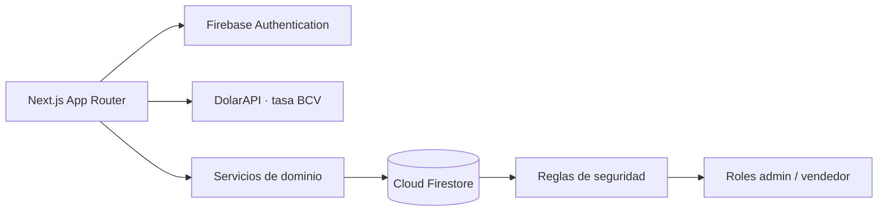

# Baterías La 19

**Sistema privado de gestión de inventario y ventas para una tienda de baterías.**

Aplicación web desarrollada para uso interno y personal de **Baterías La 19**. Centraliza el catálogo, el control de stock, el registro de ventas, la trazabilidad de movimientos y los indicadores del negocio en una interfaz rápida, consistente y adaptada a la operación diaria de mostrador.

<p>
  
  
  
  
  
</p>

> [!IMPORTANT]
> **Proyecto privado y de uso personal.**
> Este repositorio se publica únicamente como muestra de portafolio. La aplicación no es un producto público, no acepta registro de usuarios y no está destinada a instalarse, clonarse, desplegarse ni reutilizarse. Todos los derechos reservados.

---

## Descripción

Baterías La 19 es un negocio real que necesitaba reemplazar el control manual de su inventario por una herramienta precisa, rápida y sin fricción para el mostrador. El sistema resuelve el ciclo completo de operación:

- Alta, edición, activación y desactivación de baterías.
- Control de stock con umbrales mínimos y alertas de reposición.
- Registro de ventas con múltiples métodos de pago, descuentos, instalación y recepción de baterías usadas.
- Anulación de ventas con reversión automática de stock y trazabilidad.
- Historial auditable de ventas y movimientos de inventario.
- Indicadores diarios, estadísticas por período y valorización del inventario.
- Gestión de usuarios con roles de administrador y vendedor.
- Conversión de precios a bolívares con la tasa BCV vigente.

La interfaz está completamente en español y fue diseñada para funcionar tanto en escritorio como en tablet y móvil.

## Funcionalidades principales

### Inventario

Catálogo con búsqueda por código, marca o modelo, filtros por estado y disponibilidad, ordenamiento por columnas y paginación. Cada producto conserva su historial de movimientos y su valorización en dólares con referencia en bolívares.

El sistema calcula el **capital invertido**, el **valor potencial de venta** y el **margen** sobre las unidades disponibles, incluyendo productos desactivados que todavía conservan stock.

### Ventas

Flujo de venta con búsqueda de productos, control de cantidades, cálculo automático de subtotales, descuentos y totales. Permite registrar el método de pago, los datos del cliente, la instalación y la recepción de una batería usada.

Cada venta se ejecuta mediante una transacción que actualiza el stock, genera el movimiento de inventario y asigna el correlativo de forma atómica, evitando inconsistencias entre documentos.

### Historial y auditoría

Consulta paginada de ventas y movimientos con filtros por fecha, estado, vendedor, tipo y usuario. Las ventas pueden anularse dejando registro del motivo, del usuario responsable y de la reversión de stock correspondiente.

### Dashboard y estadísticas

Panel principal con los indicadores del día, últimas ventas y alertas de stock. El módulo de estadísticas permite analizar ingresos, ticket promedio, unidades vendidas, productos más vendidos y distribución por método de pago en rangos de fecha configurables.

### Seguridad y roles

Autenticación con Firebase Authentication y perfiles almacenados en Firestore. Las reglas de seguridad validan el rol y el estado del usuario en cada operación, mientras que la interfaz adapta la navegación y las acciones disponibles según el perfil.

## Arquitectura



La aplicación sigue una separación clara entre presentación, lógica de dominio y acceso a datos:

- **App Router** para las rutas públicas y privadas, con layouts y protección de sesión.
- **Componentes de UI reutilizables** y un design system propio basado en tokens.
- **Servicios de dominio** para inventario, ventas, movimientos, estadísticas, usuarios y tasa BCV.
- **Validación con Zod** antes de ejecutar operaciones sensibles.
- **Firestore** como fuente de verdad, con transacciones y lotes para mantener la consistencia.
- **Carga diferida de Firestore** fuera del bundle inicial del inicio de sesión.

### Stack

| Área          | Tecnología                                     |
| ------------- | ---------------------------------------------- |
| Framework     | Next.js 16 con App Router                      |
| Interfaz      | React 19, Tailwind CSS 4 y componentes propios |
| Lenguaje      | TypeScript en modo estricto                    |
| Autenticación | Firebase Authentication                        |
| Base de datos | Cloud Firestore                                |
| Validación    | Zod                                            |
| Iconografía   | Lucide React                                   |
| Tipografía    | Inter y JetBrains Mono con `next/font`         |
| Despliegue    | Vercel                                         |

## Estructura del proyecto

```text
src/
├── app/          Rutas, layouts y páginas
├── components/   Componentes de interfaz y módulos de negocio
├── hooks/        Hooks de datos y estado compartido
├── lib/          Servicios, validaciones y utilidades
├── providers/    Contextos de sesión y tasa BCV
└── types/        Contratos de datos del dominio
```

## Calidad

El proyecto se desarrolla con un enfoque de calidad sostenida:

- TypeScript estricto y validación de esquemas en los flujos críticos.
- Reglas de Firestore probadas con el emulador local.
- Formato y análisis estático integrados en el flujo de desarrollo.
- Componentes accesibles, navegación por teclado y contraste verificado.
- Diseño responsive para escritorio, tablet y móvil.
- Build de producción verificado antes de cada despliegue.

## Estado del proyecto

**Versión actual:** `v0.7.0` · en producción.

El sistema se encuentra en la fase de pulido final, con los módulos principales completos y validados: autenticación, inventario, ventas, historial, dashboard, estadísticas, usuarios y tasa BCV.

## Documentación

La documentación funcional, técnica y de decisiones de arquitectura se mantiene en una bóveda privada y no forma parte de este repositorio público.

## Autor

Desarrollado por [Juan17md](https://github.com/Juan17md) para Baterías La 19.

## Licencia

**Software propietario. Todos los derechos reservados.**

No se concede permiso para copiar, modificar, distribuir, sublicenciar ni utilizar este software, total o parcialmente, sin autorización expresa del titular. Este repositorio no constituye una oferta de licencia open source.
